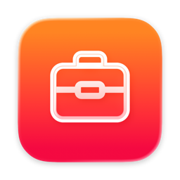
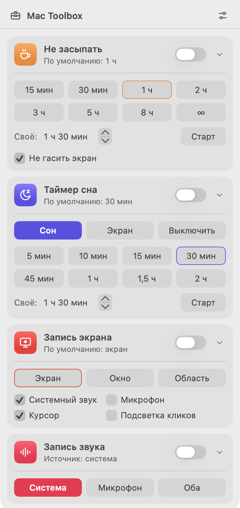

<p align="center">
  
</p>

<h1 align="center">Mac Toolbox</h1>

<p align="center">
  Нативный набор утилит для macOS в меню-баре — в духе Parallels Toolbox.<br>
  Swift 6 · SwiftUI · ScreenCaptureKit · без зависимостей
</p>

<p align="center">
  
</p>

## Инструменты

| | Инструмент | Что делает |
|---|---|---|
| ☕ | **Не засыпать** | Не даёт Mac уснуть (и, по желанию, погасить экран) на 15 мин … 8 ч, бессрочно или на своё время. |
| 🌙 | **Таймер сна** | Через заданное время отправляет Mac в сон, гасит экран или выключает его. Отсчёт можно продлить на +5/15/30 мин. |
| 🖥 | **Запись экрана** | Пишет весь экран, отдельное окно/приложение или выделенную область в HEVC `.mov` — с системным звуком, микрофоном, курсором и подсветкой кликов. |
| 🎙 | **Запись звука** | Пишет системный звук, микрофон или оба сразу (сведённые в одну дорожку) в AAC `.m4a`. |

### Как этим пользоваться

- **Переключатель** на карточке запускает инструмент с *последними* настройками: последней длительностью, последним режимом записи.
- **Клик по карточке** разворачивает её. Там выбирается точная длительность, режим или источник, и выбор сразу запускает инструмент. Значение по умолчанию обведено, активное залито.
- **Иконка в меню-баре** показывает, что сейчас работает: ящик — ничего, чашка — «Не засыпать», луна — таймер сна, кружок — идёт запись. Рядом виден обратный отсчёт или время записи (отключается в настройках ⚙︎).
- **Запись области:** протяните мышью по экрану; Esc или правый клик — отмена.
- **Запись окна:** откроется системный пикер macOS — кликните по нужному окну.
- **Остановка записи:** снова переключатель на карточке или системный индикатор записи в меню-баре. Готовый файл откроется в Finder.

Записи сохраняются в `~/Movies/Mac Toolbox` (видео) и `~/Music/Mac Toolbox` (звук). Обе папки открываются из меню настроек.

## Требования

- macOS 15 Sequoia или новее
- Для сборки: Xcode 16+ и [XcodeGen](https://github.com/yonaskolb/XcodeGen)

## Сборка и запуск

```sh
brew install xcodegen
git clone https://github.com/shmebster/mactoolset.git
cd mactoolset
make run
```

| Команда | Что делает |
|---|---|
| `make run` | генерирует проект, собирает Debug и перезапускает приложение |
| `make build` | только сборка (результат в `build/Build/Products/Debug/MacToolbox.app`) |
| `make project` | только генерирует `MacToolbox.xcodeproj` — для работы в Xcode |
| `make clean` | удаляет `build/` и сгенерированный проект |

`MacToolbox.xcodeproj` не хранится в git — источник правды `project.yml`.

## Разрешения

| Разрешение | Когда спросит | Зачем |
|---|---|---|
| Запись экрана и системного звука | первая запись экрана или звука | ScreenCaptureKit |
| Микрофон | первая запись с микрофоном | захват микрофона |
| Автоматизация → System Events | первое выключение по таймеру сна | `shut down` через AppleScript |

«Не засыпать», а также «Сон» и «Экран» в таймере сна работают без разрешений.

> [!NOTE]
> Сборка подписывается ad-hoc, поэтому после пересборки macOS может снова запросить
> доступ к записи экрана. Если доступ «сломался» — удалите Mac Toolbox из списка в
> *Системные настройки → Конфиденциальность → Запись экрана и системного звука* и выдайте заново.

## Документация

- [Архитектура и добавление нового инструмента](docs/ARCHITECTURE.md)
- [История изменений](CHANGELOG.md)
